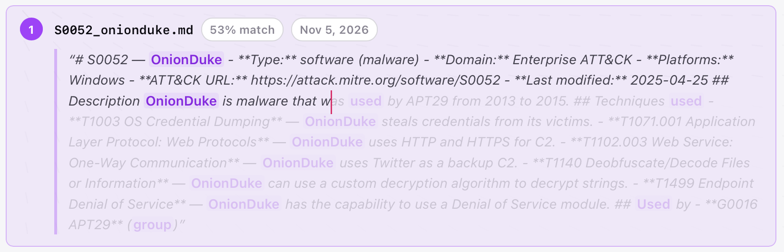

While measuring a self-built RAG, I quickly found out how important evaluation is. Adding a reranking stage cut top-1 accuracy from 0.78 to 0.62 on the golden questions. Measuring this allowed me to swap the reranking model, which improved the result to 0.89 (same prompt, same snippets).

This post shows how I set up a self-built RAG, [Condense](https://github.com/AetherisAI/condense), created a silver question/answer dataset, chose the key measurements and ran the evaluation. It closes with the outcome and what I learned from it.

## System

Condense is a self-hosted search engine for a folder of documents. It is a RAG (retrieval-augmented generation) system: it first retrieves the passages that match a question, then lets a language model write from them. Condense works in two phases. A first phase, ingest, runs once per corpus and turns every file into searchable chunks. A second phase, "Find", runs for every question and returns a single result: the best-matching file and page.

**Ingest.** The ingest pipeline starts by parsing each file to text. It then cuts the text into chunks. A chunk is a window of 512 tokens that overlaps the previous window by 64 tokens, so a sentence on a border ends up in both. The tokens are counted with the tokenizer of [bge-m3](https://huggingface.co/BAAI/bge-m3), the same model that embeds them. bge-m3 is a multilingual embedding model: it turns a text into a vector of 1,024 numbers. Finally, each vector is stored with its text, file path and page in a [libSQL](https://github.com/tursodatabase/libsql) file. 

<pre class="mermaid">
flowchart LR
  F["folder of files"] --> P["parse (markitdown)"]
  P --> C["chunk (512 tokens, 64 overlap)"]
  C --> E["embed (bge-m3)"]
  E --> DB[("libSQL file: text, path, page, vector")]
</pre>

<script type="module">
  import mermaid from "https://cdn.jsdelivr.net/npm/mermaid@11.4.1/dist/mermaid.esm.min.mjs";
  mermaid.initialize({ startOnLoad: true, theme: "neutral" });
</script>

*Ingest runs once per corpus. Every chunk ends up in one libSQL file, next to the path and page it came from.*

**Find.** A search embeds the question with the same model and compares its vector with every stored chunk by cosine distance. This is an exact search over all chunks, not an approximate index. The 30 nearest chunks then go through three stages:

1. **Version collapse** folds near-identical passages, such as two versions of the same document, into one and keeps the most recently modified copy. Two passages count as versions when their five-word sequences overlap by at least 80% (Jaccard similarity: shared sequences divided by all distinct sequences).
2. **Rerank** moves the most relevant candidate to the front (see below).
3. **Top-1.** Find returns only the first result: its file and page.

<pre class="mermaid center">
flowchart TD
  Q["question"] --> E["embed (bge-m3)"]
  E --> R["retrieve the 30 nearest chunks (cosine)"]
  DB[("libSQL file")] --> R
  R --> V["version collapse"]
  V --> RR["rerank (LLM picks 1 of the first 12)"]
  RR --> T["top-1 result: file and page"]
  R -.->|"ranking 1: retrieved"| M["sift-eval"]
  RR -.->|"ranking 2: final"| M
</pre>

*Find runs for every question. The evaluation reads the ranking twice, before and after the reranker, and the difference between "retrieved" and "final" is what the reranker did.*

**Rerank.** A reranker is a second model that reads the question and a candidate together and judges how well they fit. This is different from the embedding search, which turns the question and each chunk into vectors separately and only compares the vectors. Reading both texts at once is slower, but it can catch details that a single vector per text loses. Condense supports three strategies, selected by one config key, RERANK_STRATEGY:

- "none" keeps the embedding order.
- "crossencoder" sends the candidates to a cross-encoder such as [bge-reranker-v2-m3](https://huggingface.co/BAAI/bge-reranker-v2-m3) (model trained to score question/passage pairs).
- "llm" asks a chat model to choose.

In my case the strategy is mainly "llm" and later "crossencoder". The reranker shows the chat model the first 12 candidates, each as its file path plus the first 240 characters of the chunk, and asks for the index of the single most relevant one. The model answers with one number. That candidate moves to the front and the others keep their order. The reranker therefore picks a winner but gives no scores. This is enough for Find, which shows only one result.

The pipeline works, but the reranker only ever sees 240 characters per candidate. Question m03 of the evaluation shows what this means:

> Which group used OnionDuke, in which years, and what did it fall back to for command and control?

The embedding search puts the right file first:



*The reranker sees only the text before the red mark, the first 240 characters of the chunk. Most of it is the file's header. The answer (APT29, 2013 to 2015, Twitter as a backup C2) comes after the cut.*

This becomes important in the evaluation.

*Note:* the candidate list contains the file path. For MITRE ATT&CK the path already names the software or technique, a model that knows ATT&CK can choose from the path alone (more info in limitations).

The following runs have been executed:

| Role | Model | Where it runs |
|---|---|---|
| Embeddings (ingest and search) | bge-m3, 1,024 dimensions | Ollama, locally |
| Reranker, first run | mistral-small-latest | Mistral API |
| Reranker, second run | claude-haiku-5-5 | Anthropic API |
| Reranker, third run | bge-reranker-v2-m3 | TEI in Docker, locally (CPU) |

Condense settings are the same for all runs (see Appendix).

## Data

[MITRE ATT&CK](https://attack.mitre.org) (version 20.1) has been chosen as test data because of its complexity, depth and security topic. It also contains a lot of overlapping text, such as hundreds of "uses PowerShell" lines spread across group and software files, which makes it a good stress test for an embedder & reranker.

The data has been transformed from MITRE's STIX JSON into one Markdown file per ATT&CK object (campaigns, groups, mitigations, software, tactics and techniques) so that Condense can ingest it easily. This gives 2,298 files and 7,278 chunks.

To be able to evaluate the quality of the setup, a golden and a silver dataset have been created:

- **Golden dataset:** 112 question/answer (reference) pairs of various difficulties (easy to very hard, plus edge cases). I wrote about a fourth of them myself and Opus 5.5 wrote the rest. I reviewed every one of them. 20 of them cannot be answered from the data set, to check that the system says so instead of guessing. I also used Opus 5.5 to remove ambiguity and inconsistency, add path, evidence, answerables, tags, notes to the questions and to format them as JSON. Format for m03:

```json
{
  "id": "mitre-m03",
  "question": "Which group used OnionDuke, in which years, and what did it fall back to for command and control?",
  "reference": "APT29, from 2013 to 2015. OnionDuke used Twitter as a backup C2 channel.",
  "relevant": [
    {
      "path": "software/S0052_onionduke.md",
      "evidence": "OnionDuke uses Twitter as a backup C2"
    }
  ],
  "answerable": true,
  "tags": ["base", "has-variants", "medium", "software", "enterprise"],
  "notes": "Three facts from one short file. MiniDuke and CozyCar (also APT29, also Twitter) are decoys."
}
```

- **Silver dataset:** I used Opus 5.5 to generate 220 derivatives of the golden questions. A derivative asks the same question in a different way and keeps the gold file and answer of its base question, so both can be compared directly. Three types make up most of the set (65 questions each): keywords, scenario and German. Two smaller types change the wording: paraphrase (13) avoids the ATT&CK vocabulary, reword (12) only rewords lightly. The three main types for m03:

```json
{
  "id": "mitre-m03.keywords",
  "question": "OnionDuke group years backup C2",
  ...
  "tags": ["keywords", "variant", ...]
}
{
  "id": "mitre-m03.scenario",
  "question": "A sample we're analyzing turns out to be OnionDuke. Who is behind it, when was it in use, and where would it turn if its HTTP C2 failed?",
  ...
  "tags": ["scenario", "variant", ...]
}
{
  "id": "mitre-m03.de",
  "question": "Welche Gruppe hat OnionDuke eingesetzt, in welchen Jahren, und welchen Ausweichkanal nutzte es für Command and Control?",
  ...
  "tags": ["de", "variant", ...]
}
```

The 332 questions were then run in three batches (golden, English derivatives, German derivatives), once per reranker.

## Measurement

During the implementation of the evaluation, I ran into a lot of variables that can be measured and tracked. For my use case I decided to focus on only three. A result counts as relevant when its file is one of the question's "relevant" files (see Data).

- **precision@k:** the percentage of relevant documents among the top k results (high = better). 
- **recall@k:** the percentage of all relevant documents for the question that are in the top k results (high = better).
- **MRR (Mean Reciprocal Rank):** 1 divided by the rank of the first relevant document, averaged over all questions (high = better). Rank 1 scores 1, rank 2 scores 0.5, rank 3 scores 0.33.

The complete reports for every run are linked in the [Appendix](#appendix).

**Where measurements are taken.** The evaluation harness, "sift-eval", runs every question through the same pipeline code as the product and records the ranking at two points. The "retrieved" ranking is the raw embedding order, before collapse and rerank. The "final" ranking is what Find returns. The reranker's effect is the difference between the two, so one run gives me both the result with the reranker and the baseline without it.

## Evaluation

My goal was to measure two things: the retrieval performance of the embedding model (bge-m3) and the performance of the reranker.

- **To judge the retrieval, I focus on recall@10.** -> Is the right file among the candidates the reranker gets?
- **To judge the reranker, I focus on precision@1 and MRR.** -> Does the right file end up first?

Question m03 shows how they behave. Before the rerank, OnionDuke is on rank 1 (precision@1 = 1 and MRR = 1). The Mistral reranker moves the decoy MiniDuke in front of it, so OnionDuke drops to rank 2 (precision@1 = 0 and MRR = 0.5). recall@10 stays 1, because the right file is still in the top 10. In this case recall@10 says nothing at all about the reranker.

**Retrieval.** recall@10 is 0.95 for the golden and the German questions, and 0.88 for the English derivatives. In most cases the right file is within reach of the reranker, so the real question is the order. The English derivatives lose most, because a reworded question shares fewer words with the documents.

| Question type | n | recall@10 | recall@10 of its golden question|
|---|---|---|---|
| Golden | 92 | 0.95 | – |
| German | 63 | 0.95 | 0.94 |
| Scenario | 63 | 0.92 | 0.94 |
| Keywords | 63 | 0.90 | 0.94 |
| Reword | 12 | 0.75 | 1.00 |
| Paraphrase | 13 | 0.69 | 0.92 |
{: .center}


**Reranker.** precision@1 / MRR for every question set (n = answerable questions) and for multiple rerankers.

| Question set | n | No reranker | Mistral Small | Haiku 5.5 | bge-reranker-v2-m3 |
|---|---|---|---|---|---|
| Golden | 92 | 0.78 / 0.84 | 0.62 / 0.78 | **0.89 / 0.93** | 0.87 / 0.91 |
| English derivatives | 151 | 0.64 / 0.73 | 0.64 / 0.75 | **0.79 / 0.84** | 0.78 / 0.84 |
| German | 63 | 0.68 / 0.79 | 0.63 / 0.77 | **0.87 / 0.91** | 0.86 / 0.90 |
{: .center}

With Mistral Small, the reranker makes the result worse: precision@1 on the golden questions drops from 0.78 to 0.62. Over all 306 answerable questions it fixed 41 top-1 results and broke 60. With Haiku 5.5 (same prompt and configuration) it fixed 59 and broke 15. The cross-encoder fixed 61 and broke 21, and ends within 0.02 (one or two questions) of Haiku on every question set. 

The cross-encoder works differently from the LLM rerankers. It scores all 30 candidates on their full text, but never sees the file path. A reranker therefore does not need to know ATT&CK, or read the file name, to fix the order. It also explains why recall@10 only moves with the cross-encoder (golden 0.95 → 0.96, English derivatives 0.88 → 0.92). The LLM rerankers only move one candidate to the front, the cross-encoder reorders all 30.

However, the better rerankers was slower. A rerank takes 0.5 s on average with Mistral Small (p95: 1.0 s), 1.4 s with Haiku (p95: 2.7 s) and 46 s with the cross-encoder (p95: 52 s).

*Note:* the 46 s say more about my setup than about the model. The cross-encoder ran on CPU in a Docker VM with 4 vCPUs. On a GPU it would be far faster.

## What I learned

- recall@k with a high k cannot show the reranker's performance if most of the relevant documents are already in the top k results. This is because the reranker only moves a document a few spots. Even k = 3 was too high to measure it, so I focused on k = 1 (especially precision@1).
- bge-reranker-v2-m3 showed me how a small specialized model (cross-encoder) can match a large, latest-generation LLM (Haiku 5.5) and clearly beat a smaller, older one (Mistral Small) in quality. 
- Creating an initial golden dataset and using Opus to create a silver dataset, where every question is properly formatted, labeled and verified (especially relevant for my next post about RAGAS) allowed me to test and understand the limitation of RAG search.
- Paraphrase and reword derivatives perform noticeably worse in search. A clear question that uses the vocabulary of the documents proves to be significantly better (based on small sets of 12–13 questions).
- The importance of evaluating before and after each stage and each change of a RAG, and more importantly for a specific use case. A stage has to earn its place in the numbers.


## Limitations

- **Public data with telling file names.** MITRE ATT&CK is public and very likely part of the training data of all models used. In addition, the LLM rerankers see the file path, which in this corpus names the object ("S0052_onionduke.md"). On private documents with meaningless file names, the LLM results could be lower.
- **One run per configuration.** Each configuration ran once, and an LLM reranker can choose differently on a second run (it's still a probabilistic system). I read differences of 0.01–0.02 (one or two questions) as noise. 
- **One setup.** All results use one embedding model (bge-m3), one chunk size (512 tokens) and one prompt for the LLM rerankers (12 candidates, 240 characters each). 
- **Right file, not right passage.** This post focuses on if the right file comes first and not if the right passage inside the file comes first (both measured, reports in the Appendix).

## Appendix

**Condense settings for all runs:**

```
EMBED_MODEL=bge-m3      CHUNK_SIZE=512   CHUNK_OVERLAP=64
RETRIEVE_K=30           FINAL_K=1        VERSION_SIMILARITY_THRESHOLD=0.8
RERANK_STRATEGY=llm (first and second run), crossencoder (third run)
```

**Resources:**

- [Condense](https://github.com/AetherisAI/condense): the RAG system used in this post, including the evaluation harness "sift-eval"
- [MITRE ATT&CK](https://attack.mitre.org): the knowledge base used as test data (version 20.1)
- [attack-stix-data](https://github.com/mitre-attack/attack-stix-data): MITRE's STIX JSON, the source of the Markdown corpus
- [markitdown](https://github.com/microsoft/markitdown): converts files to Markdown during ingest
- [bge-m3](https://huggingface.co/BAAI/bge-m3): the embedding model
- [Ollama](https://ollama.com): runs bge-m3 locally
- [libSQL](https://github.com/tursodatabase/libsql): the database with native vector search
- [bge-reranker-v2-m3](https://huggingface.co/BAAI/bge-reranker-v2-m3): the cross-encoder reranker
- [Text Embeddings Inference (TEI)](https://github.com/huggingface/text-embeddings-inference): serves the cross-encoder
- [Mistral Small](https://docs.mistral.ai): the first LLM reranker (mistral-small-latest)
- [Claude Haiku 5.5 and Opus 5.5](https://docs.anthropic.com/en/docs/about-claude/models): the second LLM reranker, and the model used to create the dataset

**Reports and data:**

Every run has a report with more data than this post shows. The "retrieved" ranking in each report is the baseline without a reranker.

| Question set | Mistral Small | Haiku 5.5 | bge-reranker-v2-m3 |
|---|---|---|---|
| Golden | [report](/assets/reranker-made-results-worse/reports/20261107-130230-mitre-base/summary/) | [report](/assets/reranker-made-results-worse/reports/20261108-095518-mitre-base-haiku-rerank/summary/) | [report](/assets/reranker-made-results-worse/reports/20261109-230937-mitre-base-ce-rerank/summary/) |
| English derivatives | [report](/assets/reranker-made-results-worse/reports/20261107-160648-mitre-derivatives/summary/) | [report](/assets/reranker-made-results-worse/reports/20261108-095934-mitre-derivatives-haiku-rerank/summary/) | [report](/assets/reranker-made-results-worse/reports/20261110-092916-mitre-derivatives-ce-rerank/summary/) |
| German | [report](/assets/reranker-made-results-worse/reports/20261107-173114-mitre-de/summary/) | [report](/assets/reranker-made-results-worse/reports/20261108-100115-mitre-de-haiku-rerank/summary/) | [report](/assets/reranker-made-results-worse/reports/20261110-154421-mitre-de-ce-rerank/summary/) |
{: .center}

Datasets and scripts:

- Golden and silver dataset: [silver.jsonl](/assets/reranker-made-results-worse/silver.jsonl)
- Corpus build script (STIX JSON to Markdown): [build_corpus.py](/assets/reranker-made-results-worse/build_corpus.py)
